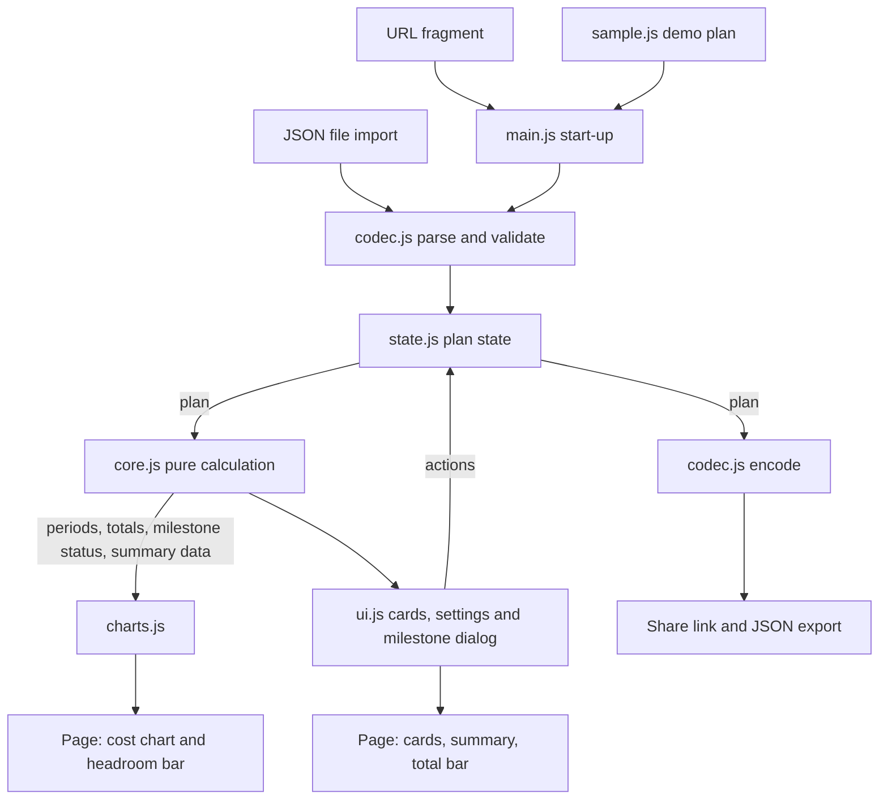
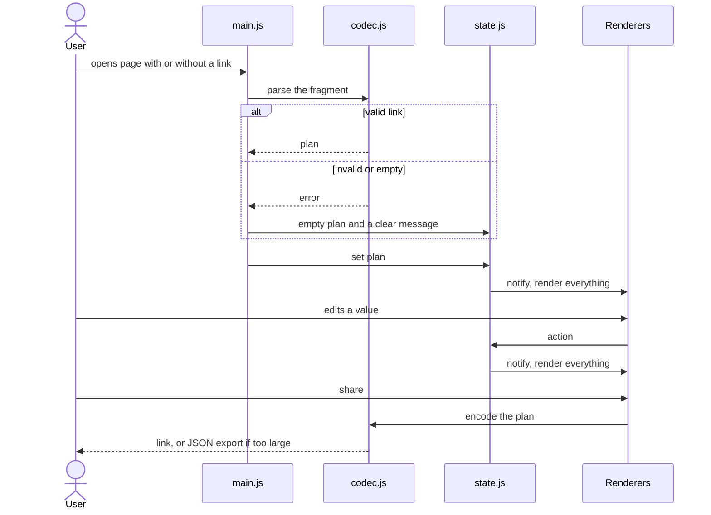

# Budgeteer: Plan

Spec: `SPEC.md`
Status: draft
Date: 2026-11-04

## Approach

Build the tool as a static page in `docs/`, following the default stack in `WORKING-MODE.md`: plain HTML, CSS and JavaScript, no build step, no runtime dependencies, no ES modules, no runtime fetching. It must work by opening `docs/index.html` from disk, from GitHub Pages and later in a static container.

The code is split so that everything that calculates is a set of pure functions with no access to the page. That part is tested with Node's built-in runner. Everything that touches the page is thin and only renders state.

Deviations from the default stack: none. Tests are used here because the calculation is the heart of the tool.

## File layout in the project repo

```text
docs/
  index.html          page structure
  style.css           dark theme, CSS variables
  js/
    core.js           pure functions: calculation, units, status, formatting, validation
    codec.js          pure functions: plan to link fragment, plan to JSON, parsing and validation
    sample.js         invented sample plan for demo mode, embedded as data
    state.js          the plan state, actions and change notification
    charts.js         cost chart and headroom bar as SVG, axis scaling, label placement, milestone markers
    ui.js             start-up of the page, settings, notice, typed headline
    ui-resources.js   resource cards
    ui-charts.js      the charts on the page
    ui-summary.js     summary and sticky total bar
    ui-milestones.js  milestone list and dialog
    ui-share.js       link, JSON export and import, new and sample plans
    main.js           start-up: read the link, demo mode, first render
tests/
  core.test.js        node --test
  codec.test.js
SPEC.md
PLAN.md
CLAUDE.md
```

Scripts are classic scripts loaded in order and share one namespace object. `core.js` and `codec.js` end with a small export line so Node can load them in tests, and they still work as plain scripts in the browser.

## Data model

```text
plan:
  version: 1
  view: "month" | "quarter"          display only, nothing is converted
  length: 1..12 months                everything is stored in months, quarter view needs a multiple of 3
  budgets: { max, stretch }
  scenario: "max" | "stretch"      (the one being viewed)
  resources: up to 20 of
    id, name, type, mode            type: internalStaff | freelancer | subscription | infrastructure | oneTime
                                    mode: fte | rateDays | fixed | oneTime
    fteCost, share                  for fte: cost per FTE and month, share of one FTE (1 is 100 percent)
    rate, days                      for rateDays
    amount                          for fixed and oneTime
    due                             period, for oneTime
    from, to                        period range, empty "to" means the last period
    on: { max: bool, stretch: bool }
  milestones: up to 8 of
    id, name (40 characters), value (140 characters)
    due                             period
    linked                          resource ids, can be empty
    importance                      "must" | "nice"
```

## Component and data flow



The direction matters: state flows down to `core.js`, results flow to the renderers, and the only way back is an action from `ui.js`. `core.js` and `codec.js` never read the page.

## Loading and sharing a plan



## Steps

Each step is small, finishable on its own, and points to the acceptance criteria it satisfies. Steps 2 to 12 happen in the project repo.

1. [x] Create the project repo, copy the spec, plan and `CLAUDE.md` into it as the first commit, and attach it to the session. The decision records stay outside this repo.
2. [x] Core logic with tests: period costs for the three modes, scenario totals, running totals, budget passed, status, milestone status with reasons, euro formatting, input validation, and the sample plan with its milestones as the test case. (AC1 to AC4, AC6, AC7, AC12, AC15, AC23, AC31 to AC33, test case)
3. [x] Spike for the link size: encode a plan of 20 resources, 12 months and 8 milestones with full-length texts in the fragment, check its length and that it restores. Decide whether compression is needed. Records the result in ADR 0002. (AC26, open question on link size)
4. [x] Page skeleton and dark theme: settings (unit, length, budgets, scenario), state and rendering loop. (AC13, AC15, AC19, AC20)
5. [x] Resource cards: template chips, sliders with number fields, More settings, scenario switch, add and remove, new resource starts in the current scenario only. (AC4, AC5, AC8, AC14, AC27)
6. [x] Cost chart with axis scaling. (AC9)
7. [x] Headroom bar with budget ticks, period slices, label placement and the passed-budget markers, status chip. (AC10, AC11, AC12)
8. [x] Narrative summary and the sticky scenario total bar. (AC12, AC16, AC22)
9. [x] Milestones: the "Add milestone" dialog with its fields, the 8 milestone and 140 character limits, markers on the cost chart, the status list comparing both scenarios, and the milestone layer of the summary. Sketch the dialog in a quick mockup first. (AC29 to AC31, AC34 to AC37)
10. [x] Link codec in the UI, restore, invalid link handling, 20 resource limit, JSON export and import. (AC17, AC18, AC26 to AC28, including milestones)
11. [x] Phone layout, keyboard use, focus, text alternatives and contrast check. (AC21, AC24, AC25)
12. [x] Demo mode with sample data, the GitHub Pages site from `main` and `/docs` (a demo first, the hosted tool later), one Actions workflow running the tests with a badge, README with outcome, demo GIF and how it was scoped, tag v0.1.0 with a changelog. (AC20, success criteria) Done: the sample plan as the default, the test workflow, README with badge, changelog and a footer with the version. Left to do by hand: merge the branch into `main`, switch on Pages (Settings, Pages, branch `main`, folder `/docs`) and tag v0.1.0, because tags cannot be pushed from the build session.

Order logic: the calculation and the link size are the main risks, so they come first, before any visual work. Charts come before the summary so the numbers can be checked visually.

## Decisions

The decision records (ADRs) are kept outside this repo, in the private planning repo. In short:

- No build step, classic scripts, no libraries, charts in HTML and SVG
- Plan state in the URL fragment as a compact JSON array, base64url, deflated when that is shorter, with a format version (2) in every link and JSON export as fallback. Older versions are not read.
- Numbers are kept unrounded, rounding only for display
- The tool is dark only
- Months are the only stored unit, quarters are a view

## Risks

- Link size: measured in step 3. A typical plan is about 470 characters, the largest plan with English-like text about 1,600, with random text about 3,000, including the Pages address. Links over 2,000 characters get a note and the JSON export is the way out.
- Label collisions next to the headroom bar and axis scaling are fiddly without a library. Mitigated by building them as small, tested pure functions where possible.
- Milestones add text to the link and a new dialog. Mitigated by the length limits, the spike in step 3, and a quick mockup before step 9.
- Quarter view editing: the rules for editing precise months in the quarter view are proposed in the spec and need your confirmation before step 5 builds the cards.
- Pages becomes the hosted tool: from now on links people share must keep working across releases, which needs a migration for the next format change. Mitigated by the plan format version in every link and AC42. Version 1 links are not read, because none were in circulation.
- Floating point: converting months to quarters and back must keep totals unchanged. Mitigated by keeping numbers unrounded and testing with a small tolerance.
