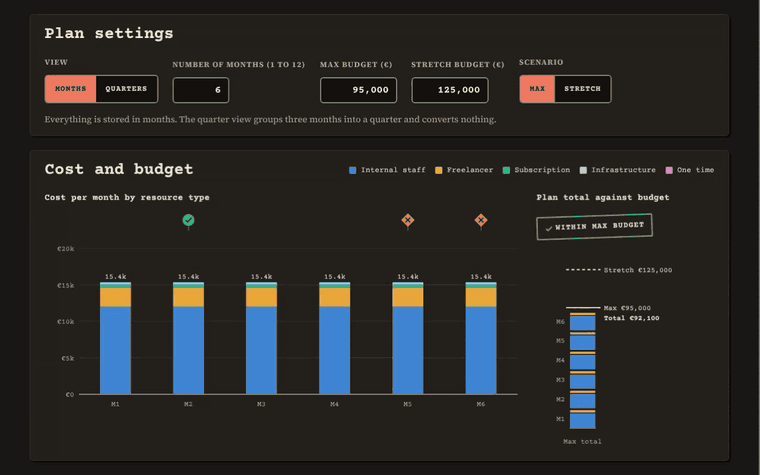
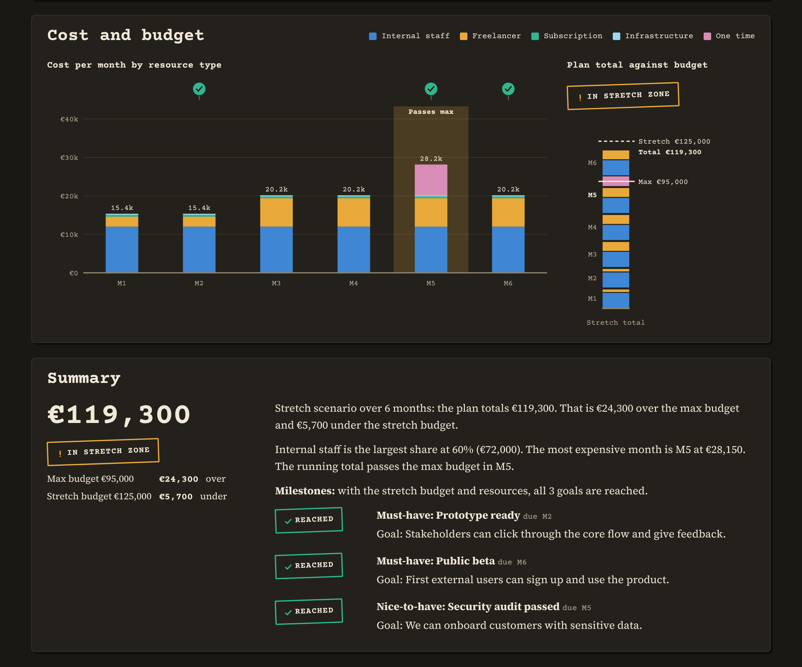
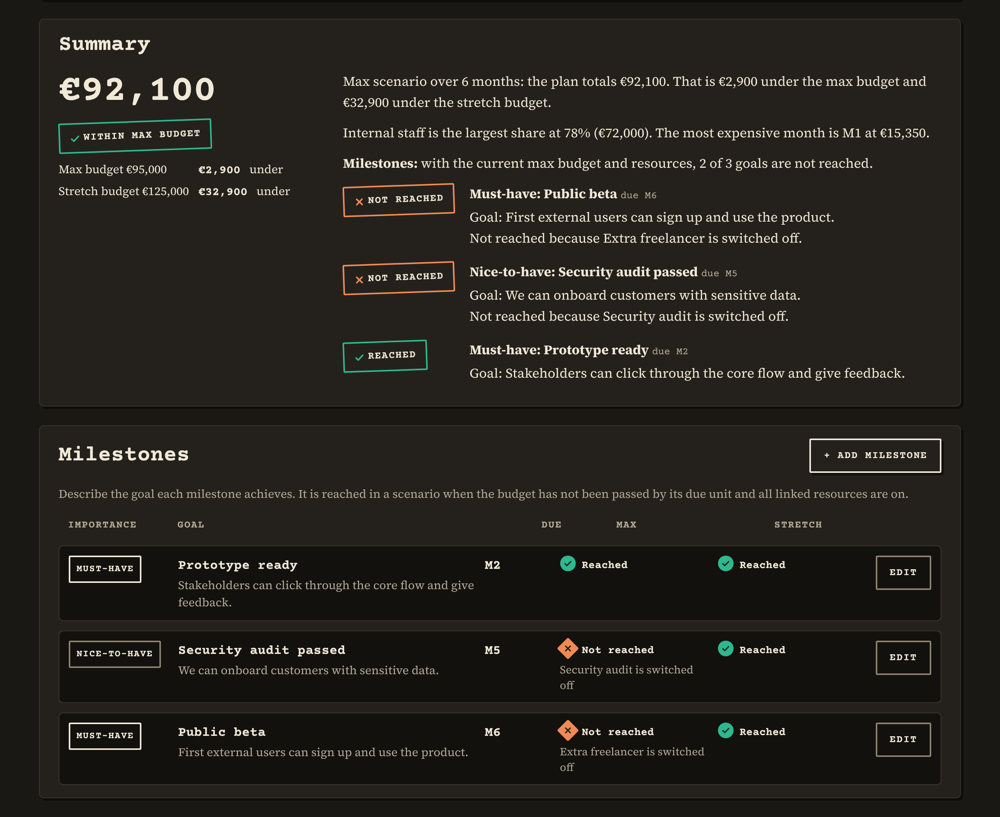

# Budgeteer

**Budget? Nudge it. Judge it.**

**[Try it now: minimumviabletools.github.io/Budgeteer](https://minimumviabletools.github.io/Budgeteer/)**

Budgeteer is a project budget calculator for product managers. Add what your project needs, see at once whether it fits your budget, and play with the plan until you can explain it.

## Why Budgeteer

Budgets are often worked out in spreadsheets where one changed resource means reworking totals and charts by hand, and the result is hard to explain to stakeholders. In Budgeteer you change a number and everything follows: the totals, the charts and a summary in plain words.

## What you can do

- **Describe resources as cards.** Add internal staff, freelancers, subscriptions, infrastructure or one-time costs, and adjust each one with sliders or exact numbers.
- **Compare two scenarios.** Keep a max and a stretch budget side by side, and switch single resources on or off in each one.
- **See where you stand.** A cost chart, a headroom bar and a short summary show how the plan compares to both budgets, and in which month it passes them.
- **Tie goals to the budget.** Add milestones with the goal they achieve, and see which ones the plan reaches in each scenario and why.
- **Share it.** Send a plan as a link, or save and open it as a file. Keep several plans open in one session to try alternatives.

## How it works

1. Open the page. It starts with a sample plan that you can change freely, or start your own with "New plan".
2. Add your resources and set your max and stretch budgets.
3. Switch between the scenarios, add milestones, and share the result.

## Your plan stays with you

Budgeteer runs in your browser, with no account and no server. A shared plan lives in the link itself, which is never sent anywhere. Open plans stay in your browser tab and are gone when you close it, so download a file if you want to keep one.

## Feedback and ideas

Found something confusing, broken or missing? Please [open an issue](https://github.com/MinimumViableTools/Budgeteer/issues/new). A few lines are enough:

- **For a problem:** what you tried, what you expected and what happened instead. If you can, add the share link or the downloaded file of the plan, but only if it holds no confidential data.
- **For an idea:** the situation you are in and what you would like to do. The problem matters more than the solution.

Open ideas and known requests are listed under [Issues](https://github.com/MinimumViableTools/Budgeteer/issues). Add a comment if one of them matters to you.

## Status and license

Budgeteer is an early demo. What changed in each version is in the [changelog](CHANGELOG.md). It is free to use under the [MIT license](LICENSE).
