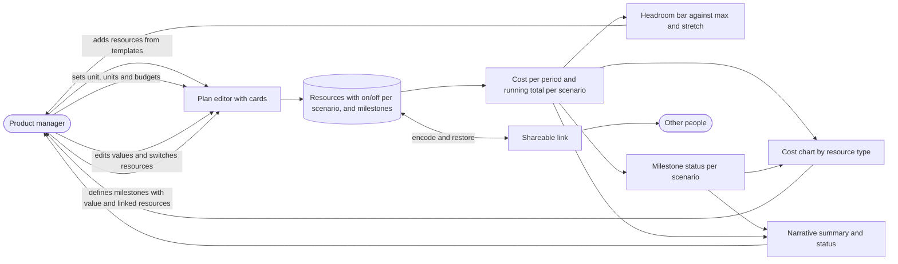

# Budgeteer: Spec

Status: draft
Date: 2026-11-04

Plan: `PLAN.md`. Decisions: `adr/`.

## Problem

A product manager has to commit to a budget and needs to see what spending allocations fit within a maximum and a stretch budget. Today this happens in ad hoc spreadsheets where changing one resource means reworking totals and charts by hand, and the result is hard to explain to stakeholders.

## Outcome

A product manager can describe the resources of a plan, see immediately how the total compares to a maximum and a stretch budget, adjust single resources like playing with scenarios, and share the plan with a link. The tool runs by opening a local HTML file or from its GitHub Pages site. At first that site is a demo with sample data, and later it becomes the actual hosted tool.

## Scope

- Resources are set up as cards, not a table. A row of template chips adds a resource with defaults: internal dev, freelancer, subscription, infrastructure, one-time cost.
- Each card shows the line total for the plan, its share of the scenario total, and sliders with a number field beside each for exact input. A collapsed "More settings" section holds resource type, cost mode, start period and end period.
- Cost modes: rate times days, fixed per period, one time.
- A total timeframe of at most one year, stored in months. The planning unit is a view: months (1 to 12) or quarters (1 to 4, available only when the plan length is a multiple of 3 months). Weeks are not a planning unit.
- Two scenarios, max and stretch. One shared resource list, with a different combination of on/off switches per resource in each scenario. The budgets are one per scenario.
- A switch on each card includes or excludes the resource in the scenario currently viewed, labelled "In max" or "In stretch". A resource that is switched off is dimmed and shows "Not in max" (or stretch) instead of its share.
- A resource added while viewing a scenario starts on in that scenario only and off in the other.
- Overview with the cost chart (stacked bars per period by resource type), the headroom bar (the plan total stacked by period against the max and stretch budgets), a status chip, and a narrative summary with live numbers.
- The chart highlights the period in which the running total first passes a budget.
- Value-based milestones: up to 8, each with a name, a short value description of the goal achieved (up to 140 characters), a due planning unit, linked resources, and an importance (must-have or nice-to-have). They are defined in a dialog opened by an "Add milestone" button.
- A milestone is reached in a scenario when the budget has not been passed by its due unit and all its linked resources are on in that scenario. Milestones appear as markers on the cost chart, in a status list that compares both scenarios, and in a new layer of the narrative summary that says which goals are not reached with the current budget and resources.
- A sticky scenario total bar at the bottom of the resources section, with the scenario total, a fill bar against max and stretch, and the status chip. It stays visible while scrolling the cards.
- Fixed euro currency, English UI, one fixed number format that does not depend on the browser, for example €92,100.
- The tool is dark only.
- Shareable link that restores the plan, in a static page with no server. The plan is encoded in the URL fragment. A plan holds at most 20 resources. JSON export and import is the fallback if a link cannot carry a plan.

## Non-goals

- Scoring or ranking initiatives.
- Several initiatives with shared resources (later).
- Percentage-of-cost mode (later; the agreed base is a selected resource line).
- Units other than days for rate times days, such as hours or licences (later).
- A table view of the resources.
- Accounts, a backend, integrations, or stored data on a server.
- Other currencies or currency conversion.

## Context diagram

## Calculation rules

For each resource and period p from 1 to n, with `from` defaulting to 1 and an empty `to` meaning n:

- Rate times days: rate times days if from <= p <= to, else 0.
- Fixed per period: the amount if from <= p <= to, else 0.
- One time: the amount if p equals the due period, else 0.

The scenario total is the sum over the resources that are on in that scenario. A budget is passed in period p when p is the first period whose running total is strictly greater than the budget.

All calculations are done on months. The quarter view groups months into quarters for display only, so a marker, a bar or a label shows the quarter that contains the month.

A milestone has a due period d (1 to n), a set of linked resources (can be empty), an importance, a name and a value description. In a scenario with budget B, the milestone is reached when both hold:

- The budget has not been passed by period d: the running total is not above B in any period up to and including d. This is the same rule as the passed-budget marker, so the milestone is reached if B is never passed or if the period in which B is first passed comes after d.
- Every linked resource is on in that scenario. With no linked resources, only the budget decides.

If a milestone is not reached, its reason is either "budget passed in period p" (the period in which B is first passed, at or before d) or "resource X is switched off". If both hold, both reasons are listed. Resources that run longer than d do not matter beyond their cost up to d, which is what the running total already contains.

Status: total <= max is "Within max budget" (green). Total above max and <= stretch is "In stretch zone" (amber). Total above stretch is "Over stretch budget" (red).

Template defaults (can be tuned): internal developer 1,000 per day for 10 days; freelancer 650 per day for 5 days; subscription 200 per period; infrastructure 300 per period; one-time cost 5,000 due in the middle period.

## Acceptance criteria

- AC1: Given a plan of 6 months and a fixed line of 500 euro per month, when the line is on, then every month shows 500 and the total is 3,000.
- AC2: Given a rate times days line with a day rate of 600 and 8 days per period, when the line is on, then each period shows 4,800.
- AC3: Given a one-time line of 2,000 due in period 3, when the line is on, then only period 3 shows 2,000.
- AC4: Given a line with start period 3 and end period 6 in a 6-month plan, when the line is on, then it costs nothing in periods 1 and 2; and given an empty end period, then it runs to the last period.
- AC5: Given a resource that is on in the scenario being viewed, when its switch is turned off, then it is dimmed, labelled "Not in max" (or stretch), and excluded from that scenario's totals, chart and summary, and the other scenario is unchanged.
- AC6: Given two scenarios that share one resource list, when a value is changed on a card, then the change applies in both scenarios, and the totals of each scenario update according to which resources are on.
- AC7: Given a resource that is on in max and off in stretch, when the scenario is switched, then the stretch view dims the resource and excludes it from its totals while the max view includes it.
- AC8: Given the user is viewing the stretch scenario, when a resource is added from a template chip, then it starts with the template defaults, is on in stretch and off in max.
- AC9: Given a plan with lines of two resource types, when the overview is shown, then the cost chart shows one bar per period split by resource type, and the bar heights match the period totals.
- AC10: Given a scenario total, when the overview is shown, then the headroom bar shows the total stacked by period, with a solid tick for the max budget and a dashed tick for the stretch budget, each labelled with name and amount.
- AC11: Given a running total that first exceeds the max budget in period 5, when the overview is shown, then period 5 is highlighted in the cost chart with the label "Passes max", and its label in the headroom bar is bold. If max and stretch are passed in the same period, the label reads "Passes max + stretch".
- AC12: Given a max budget of 95,000 and a stretch budget of 125,000, when a scenario total is 119,300, then the status chip reads "In stretch zone" and the summary states that the total is 24,300 over the max and 5,700 under the stretch.
- AC13: Given the user changes a slider, a number field, a switch, the scenario, the unit, a budget, or adds or removes a card, when the change is made, then the chart, headroom bar, summary and status update without a page reload.
- AC14: Given a slider with a number field beside it, when a larger value than the slider range is typed, then the value is accepted and the slider range grows.
- AC15: Given a timeframe longer than one year, when it is entered, then the tool sets it to the maximum and shows "A plan can have at most 12 months." or "A plan can have at most 4 quarters.", according to the unit.
- AC16: Given a scenario with no active resources, when the overview is shown, then the summary shows a short hint to switch one on or add one.
- AC17: Given a plan, when the shareable link is opened in a new browser, then the same unit, units, budgets, resources and the on/off state per scenario are restored.
- AC18: Given a link that is invalid or cut off, when it is opened, then the tool shows an empty plan with a clear message and does not crash.
- AC19: Given a plan of 6 months, when the unit is switched to quarters, then the cost chart, the headroom bar and the cards show 2 quarters (Q1 is M1 to M3), every scenario total and milestone status is unchanged, and no stored value has changed. Switching back to months shows the original values exactly, including starts, ends, due months and milestone due months. Given a plan whose length is not a multiple of 3 months, when the quarter view is chosen, then it is unavailable with a short hint.
- AC20: Given the tool files are opened from disk, when `docs/index.html` is loaded, then everything works without a server or network.
- AC21: Given a phone width of 390 px, when the overview is shown, then everything stacks into one column and long resource names are not cut off by the switch and label.
- AC22: Given a resource list longer than the viewport, when the user scrolls the cards, then the scenario total bar stays visible with the current total, the fill against max and stretch, and the status chip, and it updates live.
- AC23: Given a total of 92100, when it is shown anywhere in the tool, then it reads exactly €92,100 regardless of the browser language, so tests and demos give identical output.
- AC24: Given the tool is used with the keyboard only, when the user tabs through it, then every slider, number field, switch, chip and button can be reached and operated, and the focus is visible.
- AC25: Given the cost chart and headroom bar, when a screen reader is used, then the narrative summary and a text alternative of each chart give the same information as the visuals, and text and controls meet WCAG AA contrast in the default dark theme.
- AC26: Given a plan with 20 resources, 12 months and 8 milestones with full-length descriptions, when the link is created and opened in a new browser, then the plan is restored completely.
- AC27: Given a plan with 20 resources, when the user adds another, then the tool refuses with a short message to remove one first.
- AC28: Given a plan, when it is exported as JSON and imported again, then the resulting plan is identical, and an invalid file shows a clear message and changes nothing.
- AC29: Given the user opens the "Add milestone" dialog, when a name, a value description of up to 140 characters, a due unit, linked resources and an importance are entered and saved, then the milestone appears in the milestone list, as a marker at its due unit on the cost chart, and in the summary.
- AC30: Given a value description longer than 140 characters, when it is typed, then the input stops at 140 characters and shows the remaining count. Given 8 milestones, when the user tries to add another, then the tool refuses with a short message.
- AC31: Given a milestone due in period 5 with a linked resource that is off in the scenario being viewed, when the status is shown, then the milestone is not reached and the reason names the switched-off resource.
- AC32: Given a scenario whose running total first passes the budget in period 5, when a milestone is due in period 4, then it is reached; and when a milestone is due in period 5 or later, then it is not reached and the reason is "budget passed in period 5".
- AC33: Given a milestone without linked resources, when its status is computed, then only the budget decides.
- AC34: Given the milestone status list, when it is shown, then each milestone shows reached or not reached for max and for stretch next to each other, with importance, due unit and reason.
- AC35: Given milestones that are not reached in the viewed scenario, when the narrative summary is shown, then it names the must-have goals first and the nice-to-have goals second, each with its value description and reason, and if all are reached it says so.
- AC36: Given a linked resource is removed, when the milestone is shown, then the link to it is gone and the milestone remains. Given a resource is switched on or off, a budget changes, or a due unit changes, then milestone status, markers, list and summary update without a page reload.
- AC37: Given the milestone dialog, when it is used with the keyboard only, then every field can be reached and operated, Escape closes it, focus returns to the button that opened it, and a screen reader announces its title and any input error.
- AC38: Given the quarter view and a fixed line of 450 per month, when the card is shown, then it shows 1,350 per quarter; and when the user types 1,500, then the stored monthly value becomes 500 and the month view shows 500.
- AC39: Given a resource that starts in month 2, when the quarter view is shown, then its start reads "Q1 (M2)" and nothing changes; and when the user edits the start there and chooses Q2, then the stored start becomes month 4, and the end of a resource edited the same way becomes the last month of the chosen quarter.
- AC40: Given a one-time cost due in month 5 and a milestone due in month 5, when the quarter view is shown, then both show Q2 with their month and keep their exact month; and when either is edited in the quarter view to Q2, then the one-time cost moves to month 4 and the milestone to month 6.
- AC41: Given a new plan, when it is created in the quarter view with a length of 2 quarters, then it is stored as 6 months and the month view shows it as 6 months.
- AC42: Given a link made by an earlier release (an older plan format version), when it is opened in a later release, then the plan is upgraded and restored completely. Given a link with a newer version than the tool knows, when it is opened, then the tool shows a clear message that the link comes from a newer release and changes nothing.

## Test case

The sample plan, 6 months, max budget 95,000 and stretch budget 125,000. Use it to check the calculation.

| Resource | Type | Mode | Inputs | Max | Stretch |
| --- | --- | --- | --- | --- | --- |
| Core team | Internal dev | Rate times days | 1,200 x 10 days | on | on |
| Freelance designer | Freelancer | Rate times days | 650 x 4 days | on | on |
| Analytics tool | Subscription | Fixed | 450 | on | on |
| Hosting | Infrastructure | Fixed | 300 | on | on |
| Security audit | One time | One time | 8,000 in M5 | off | on |
| Extra freelancer | Freelancer | Rate times days | 600 x 8 days, M3 to M6 | off | on |

- Max: 15,350 every month, total 92,100, within max (2,900 under). No budget passed. Internal dev is 78 percent.
- Stretch: months 15,350 / 15,350 / 20,150 / 20,150 / 28,150 / 20,150. Running total 15,350 / 30,700 / 50,850 / 71,000 / 99,150 / 119,300. Total 119,300, in the stretch zone, max passed in M5, stretch not passed (5,700 under). Internal dev is 60 percent.

The plan is one resource list, with the audit and the extra freelancer off in max and on in stretch.

Milestones for the test case:

| Milestone | Importance | Due | Linked resources |
| --- | --- | --- | --- |
| Prototype ready | must-have | M2 | Core team, Freelance designer |
| Security audit passed | nice-to-have | M5 | Security audit |
| Public beta | must-have | M6 | Core team, Extra freelancer |

- Max (budget 95,000): Prototype ready reached (running total 30,700 at M2). Security audit passed not reached, the audit is switched off. Public beta not reached, the extra freelancer is switched off.
- Stretch (budget 125,000): all three reached. Max being passed in M5 does not matter here, because the stretch budget decides in the stretch scenario.
- Variant for the budget rule: with a stretch budget of 100,000 the budget is first passed in M6 (99,150 at M5, 119,300 at M6), so Security audit passed (M5) is reached and Public beta (M6) is not reached with the reason "budget passed in M6".

## Success criteria

- A user who has never seen the tool can enter a plan of five resources and read the result within a few minutes without instructions.
- The demo mode loads invented sample data and shows all views.
- The GitHub Pages site can become the actual hosted tool without changing how people use it: links people have shared keep working in later releases.
- The repo is finished at this scope: no open features required to use it, and no maintenance needed.

## Decisions

- Budget display: the headroom bar. The plan total is shown as one bar next to the cost chart with ticks for max and stretch, because budgets are totals and total against total is the honest comparison. Reference lines on the cost chart would suggest a per-period cap that does not exist, and cumulative zones would hide the shape of each period.
- The headroom bar is stacked by period, and the cost chart marks the period where a budget is passed. Accepted trade-off: the share per resource type is no longer one solid block, so the summary names the largest share instead.
- Resources are set up as cards with sliders and number fields. The table view is dropped.
- One switch per card, for the scenario being viewed.
- New resources start in the current scenario only.
- One shared resource list, with a different combination of on/off switches per resource in each scenario. Separate resource plans per scenario with their own values were considered and moved out of this version.
- A plan covers at most one year: up to 12 months or up to 4 quarters.
- Months are the only stored unit. Quarters are a view of the same data (Q1 is M1 to M3, and so on). Switching the unit changes the view only: nothing is converted, no stored value changes, and totals and milestone statuses are identical in both views, so a round trip cannot lose anything. Weeks were removed as a planning unit, because 52 weeks do not divide evenly into 12 months. The 48-week model calendar was rejected earlier because it distorts the year. An earlier idea of converting values at the switch was replaced by this model, because periods such as a start in month 2 or a due date in month 5 do not convert cleanly into quarters.
- Visual language: the shared Pocketknife design, copied into `docs/design/` (tokens, fonts and components). Budgeteer uses the Ink theme only, with `ribbon` as its accent. Resource type colours are the `data-*` tokens and status colours the `status-*` tokens, the same in chart, cards, chips and legend, and identical in every tool. Max is a solid line, stretch is dashed.
- The scenario total bar is in. It keeps the effect of a slider visible while adjusting cards, especially on a phone.
- Numbers use one fixed English format that does not depend on the browser, for example €92,100, so tests and demos are deterministic.
- Accessibility is an acceptance criterion from the start: keyboard use, text alternatives for the charts, contrast.
- A plan holds at most 20 resources. The plan is encoded in the URL fragment, which is never sent to a server. JSON export and import is the fallback. The practical link size still has to be checked with a prototype in the plan phase.
- The tool uses the Ink (dark) theme only in version 1. Colours, contrast checks and screenshots are made for Ink. The Paper theme is a later item.
- Rate times days keeps "days" in version 1. The unit is stored as a label, so hours or licences can be added later without changing the data model.
- Slider ranges and styling are decided in the plan and build phase, not in the spec. Default slider tracks do not work on the dark theme and need a custom style.
- Editing in the quarter view: per-quarter values show three times the monthly value, and typing a value sets the monthly value to that value divided by 3. Start, end, one-time due and milestone due that were set precisely in the month view show their quarter with the month, for example "Q1 (M2)", and stay untouched until edited in the quarter view. Editing them there snaps them to quarter boundaries: start to the first month of the chosen quarter, end to its last month, one-time due to its first month, milestone due to its last month. A one-time cost counted early is the conservative choice for budget checks, and a milestone due at the end of its quarter means "by the end of that quarter". New plans can be created in either view.
- Milestones are value based: each describes the goal achieved when it is reached. A milestone is linked to a planning unit, because resources may run longer than the milestone and only contribute to it up to its unit. It is reached in a scenario if the scenario's own budget has not been passed by that unit and all linked resources are on.
- Milestone fields: name, value description (up to 140 characters), due unit, linked resources, importance with two levels (must-have, nice-to-have). Up to 8 milestones. The name is limited to 40 characters. A milestone may link a resource that starts after its due unit, with a short warning in the dialog, because that resource would contribute nothing to it.
- Milestones are defined in a dialog opened from an "Add milestone" button. They show up in the summary, as markers on the cost chart, and in a status list that compares both scenarios.
- GitHub Pages is the hosted version: a demo with sample data at first, the actual hosted tool later. Everything stays in the browser, so the hosted tool stores nothing about its users, and the shared plan lives in the URL fragment, which is never sent to a server. The address and the link format must therefore stay stable, and every plan link carries a format version.
- Name: Budgeteer.

## Open questions

- Practical size of the shareable link: does a plan of 20 resources, 12 months and 8 milestones with 140-character descriptions fit comfortably? Milestone texts add roughly 1.5 KB before encoding (an estimate). Check with a prototype in the plan phase.
- Slider ranges and styling: to be tuned in the plan and build phase. The starting ranges (day rate 0 to 2,000 in steps of 50, days 0 to 22 in steps of 0.5, fixed cost 0 to 2,000 in steps of 10, one-time 0 to 30,000 in steps of 250) are the starting point.

## Hard parts without a library

The real product stays dependency-free. These need real care:

- Axis scaling: round tick steps (1, 2, 2.5 or 5 times a power of ten) and a top value with some headroom.
- Label collisions next to the headroom bar when values are close (for example 119,300 next to 125,000).
- Period labels in the headroom bar: thin slices get no label unless they are a crossing period.
- Responsive sizing and readable text at narrow widths.
- Accessibility, see AC24 and AC25.

Plain SVG or HTML is easier than canvas for all of these, because text and hit targets come for free.

## Later

- Several initiatives that share resources.
- Separate resource plans per scenario with their own values, and copying a plan between scenarios.
- Percentage-of-cost resources based on a selected resource line.
- A light theme.
- Units other than days, such as hours or licences.
- Weeks as a planning unit. The exact factor would be 1 quarter = 13 weeks, 1 month = 13/3 weeks.
- Side-by-side comparison of max and stretch as two thin headroom bars. A cheaper interim idea: show the other scenario's total as a number in the summary.
